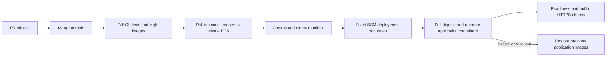

# Automatic cloud delivery

After successful **push CI on main**, Cloud release publishes the exact eight
CI-built application images to private ECR repositories, assembles an immutable
digest manifest, and invokes a fixed SSM deployment document on the existing
EC2 host. It does not build application images again on EC2. CI artifacts are
downloaded from the verified source CI run, not from a pull request or an
unrelated latest run. The source must still be main HEAD before deployment.



The existing required `CI passed` check remains. Main validates every deployed
component, including Voice Assist; pull requests retain affected-component checks.
Tests never invoke live OpenAI. Each service's API and workers share its image.
The six database containers, RabbitMQ/Mailpit, existing keys and cloud environment
are not replaced by the application rollout. The current method is in-place and
briefly interrupts requests/connections; it is not blue/green or zero-downtime.

## One-time setup order

Do not arm delivery until the AWS setup and host bootstrap below are complete.
Until `FOC_CD_ENABLED=true`, the release workflow reports the setup requirement
without an AWS request. ECR storage and retained GitHub image artifacts consume
storage. Monitor storage usage and retain the images needed for rollback.

### 1. Prepare reviewed policies on the PC

From the repository root, using Python and AWS CLI in VS Code Bash:

```bash
aws sso login --profile foc
```

Check the repository's actual OIDC prefix (new repositories use immutable IDs):

```bash
gh api repos/AY2627S1-CS3219-P6/foc/actions/oidc/customization/sub
```

The subject prefix for this repository is
`repo:AY2627S1-CS3219-P6@327778797/foc@1365308998`. Prepare exact-account,
exact-instance JSON, without making AWS requests:

```bash
python deploy/aws/scripts/prepare_delivery.py \
  --account-id 773317599268 \
  --instance-id i-04e13b58b6a5cc072 \
  --cloudfront-id E1TWM094SG8FTT \
  --oidc-subject 'repo:AY2627S1-CS3219-P6@327778797/foc@1365308998:ref:refs/heads/main'
```

Review the four generated `deploy/aws/delivery-*.local.json` files; they are
ignored. The helper refuses to overwrite existing operator edits. Reuse the
reviewed files on retries. It creates no role, repository, identity provider or
SSM document. Scope:

- Trust: GitHub issuer, STS audience and exact main subject only; no PR/branch wildcard.
- Publisher role: image upload/read for the eight exact `foc/<artifact>` repositories.
- Deployment role: read-only preflight and SendCommand using only
  `FoC-DeployRelease` on the one existing instance. It cannot start instances,
  create resources or invoke `AWS-RunShellScript`.
- EC2 role addition: ECR authentication and pull for the eight repositories;
  existing SSM and SES permissions stay in place.

### 2. Create the missing AWS resources from the PC

Check existing resources before retrying a creation command. The setup operator
needs permission to create ECR repositories, an IAM OIDC provider, scoped IAM
roles/policies and the SSM document. If denied, resolve the stated account-policy
restriction without broadening the application roles to administrator permissions.

```bash
aws iam create-open-id-connect-provider --profile foc \
  --url https://token.actions.githubusercontent.com --client-id-list sts.amazonaws.com
```

```bash
for service in web-client user-service supplier-service order-service credit-service chat-service admin-service voice-assist-service; do
  aws ecr create-repository --profile foc --region ap-southeast-1 \
    --repository-name "foc/$service" --image-tag-mutability IMMUTABLE \
    --query repository.repositoryName --output text --no-cli-pager || break
done
```

```bash
aws iam create-role --profile foc --role-name foc-github-publish \
  --assume-role-policy-document file://deploy/aws/delivery-trust.local.json
```

```bash
aws iam put-role-policy --profile foc --role-name foc-github-publish \
  --policy-name FoCImagePublish --policy-document file://deploy/aws/delivery-publish.local.json
```

```bash
aws iam create-role --profile foc --role-name foc-github-deploy \
  --assume-role-policy-document file://deploy/aws/delivery-trust.local.json
```

```bash
aws iam put-role-policy --profile foc --role-name foc-github-deploy \
  --policy-name FoCReleaseDeploy --policy-document file://deploy/aws/delivery-deploy.local.json
```

```bash
aws iam put-role-policy --profile foc --role-name foc-ec2-role \
  --policy-name FoCEcrPull --policy-document file://deploy/aws/delivery-pull.local.json
```

The fixed SSM document accepts only deploy/rollback and a bounded Base64 manifest.
It runs the preinstalled helper as `ssm-user`, not an arbitrary caller-provided
shell script. It uses SSM environment-variable parameter interpolation and needs
a current SSM agent supporting that feature. No SSH port/key is required.

```bash
aws ssm create-document --profile foc --region ap-southeast-1 \
  --name FoC-DeployRelease --document-type Command --document-format JSON \
  --content file://deploy/aws/ssm/deploy-release.json --no-cli-pager
```

The workflow explicitly invokes document version 1. Review/version the document
and update the workflow together before changing that contract.

### 3. Merge the reviewed implementation and bootstrap the existing host

Merge through a PR after CI passes. Start EC2 deliberately, wait for SSM readiness
and update CloudFront's existing origin if the public EC2 DNS changed. The release
preflight detects an outdated origin but does not change CloudFront or start EC2.

In Session Manager Bash as `ssm-user`:

```bash
cd /opt/foc
git status --short --branch
```

If the checkout has unexpected changes, inspect them first. Otherwise:

```bash
git pull --ff-only origin main
aws --version
```

The host needs AWS CLI v2 on PATH. If absent, install it using the
[official Linux x86-64 instructions](https://docs.aws.amazon.com/cli/latest/userguide/getting-started-install.html).
Do not configure access keys on EC2: ECR pulls use the existing instance role.
This pipeline targets the current x86-64 EC2 and Linux/amd64 images.

```bash
python3 deploy/aws/scripts/deploy_release.py baseline
python3 deploy/aws/scripts/deploy_release.py status
```

Baseline reads only the six services' Supabase migration metadata using existing
operator credentials, verifies the applied versions against canonical migration
filenames and records their file fingerprints privately. It performs no DDL,
business-table query, reset or credential rotation. If it fails, review and apply
the owning service's migrations deliberately before retrying. Never invent an
empty baseline or change the recorded fingerprints to bypass a failure.

### 4. Set non-secret GitHub repository variables and arm delivery

In GitHub **Settings → Secrets and variables → Actions → Variables**, add:

| Variable | Value for the current account |
| --- | --- |
| `FOC_AWS_ACCOUNT_ID` | `773317599268` |
| `FOC_EC2_INSTANCE_ID` | `i-04e13b58b6a5cc072` |
| `FOC_CLOUDFRONT_ID` | `E1TWM094SG8FTT` |
| `FOC_PUBLIC_ORIGIN` | `https://d3oi8busaydf0w.cloudfront.net` |
| `FOC_BUILD_ROLE_ARN` | `arn:aws:iam::773317599268:role/foc-github-publish` |
| `FOC_DEPLOY_ROLE_ARN` | `arn:aws:iam::773317599268:role/foc-github-deploy` |
| `FOC_CD_ENABLED` | `true`, only after host setup |

These are identifiers, not secrets. Do not upload database passwords, JWT keys,
the OpenAI key or the cloud `.env` to GitHub. AWS authentication uses short-lived
OIDC role sessions. Do not add a GitHub environment to these jobs without updating
the OIDC trust: environment-scoped jobs have a different subject format.

For the first release, use **Actions → Cloud release → Run workflow → main → deploy**.
It requires successful full push CI for that exact current main SHA and downloads
its eight image artifacts. Later successful main CI runs trigger it automatically.
If the three-day CI image artifacts expired, rerun main CI; the pipeline will not
silently rebuild another image under the already-tested release.

## Deployment and rollback behavior

The host serializes all operator/SSM release actions with a nonblocking file lock;
GitHub also serializes release workflows without cancelling an active rollout.
It checks installed Compose/Nginx fingerprints and migration baseline, captures
the running application image IDs, and pulls every new ECR digest before changing
containers. It recreates application APIs/workers only, using `--no-build`,
`--no-deps` and `--pull never`. An API and its workers use the same artifact.

If the rollout or local readiness fails, it restores the captured image IDs and
checks readiness again. A failed rollback is explicitly recorded as failed;
do not assume either version is healthy. The local rollback target is retained,
so repeating operator rollback does not toggle back to the rejected version.
Do not prune retained Docker images or the private `.release-state` directory.

Readiness checks container health, short worker process stability and the local
public-origin listener; the runner separately checks public HTTPS. A worker being
Up does not prove queue consumption. These checks do not establish successful
Order/Credit settlement, authenticated browser flows, load targets or resilience
to EC2 failure. A public-only failure after a healthy host rollout is reported for
ingress investigation; it does not blindly roll back otherwise healthy images.

Use **Cloud release → Run workflow → main → rollback** to restore the previous
application images. It does not roll back database schemas, `.env`, credentials,
external provider settings or infrastructure. Keep schema/configuration changes
backward compatible and review them separately; future data migrations are not
automatic. Changed Compose/Nginx or migration fingerprints block an app rollout
until the host contract is deliberately updated and baseline checked.

Private host records:

- `.release-state/schema.json`: reviewed migration fingerprints.
- `.release-state/active.compose.json`: currently selected application images.
- `.release-state/current.json` and `previous.json`: current release/rollback metadata.
- `.release-state/history.jsonl`: timestamps, commit/release IDs and outcomes.

Manifest JSON is retained as a GitHub artifact; it contains image references and
checksums, never secret values. GitHub/SSM failures suppress provider output that
might contain credentials. History and outcome summaries identify the failed phase.

After CD has deployed, include its active image overlay in any manual application
recreation, including a key-only Voice Assist update. Otherwise base Compose can
select an old locally built image:

```bash
sudo docker compose --env-file deploy/aws/.env \
  -f deploy/aws/compose.yaml -f deploy/aws/compose.public.yaml \
  -f deploy/aws/.release-state/active.compose.json \
  --profile voice-assist up -d --no-deps --no-build --pull never voice-assist-service
```

## Sources and verification

- [GitHub OIDC subject formats](https://docs.github.com/en/actions/reference/security/oidc)
- [AWS credentials action and OIDC setup](https://github.com/aws-actions/configure-aws-credentials)
- [SSM parameter interpolation](https://docs.aws.amazon.com/systems-manager/latest/userguide/documents-schemas-features.html)
- [SSM scoped policy examples](https://docs.aws.amazon.com/systems-manager/latest/userguide/security_iam_id-based-policy-examples.html)
- [ECR push permissions](https://docs.aws.amazon.com/AmazonECR/latest/userguide/image-push-iam.html)
- [ECR registry authentication](https://docs.aws.amazon.com/AmazonECR/latest/userguide/registry_auth.html)

Run `python -m unittest discover -s deploy/aws/tests -v`, the pinned cloud Ruff
checks and actionlint on the workflows. Recovery tests exercise real private
metadata/files and simulated Docker/PostgreSQL boundaries. Validate live OIDC,
ECR push/pull, SSM rollout, rollback and authenticated business flows in the target
environment before enabling automatic delivery.
