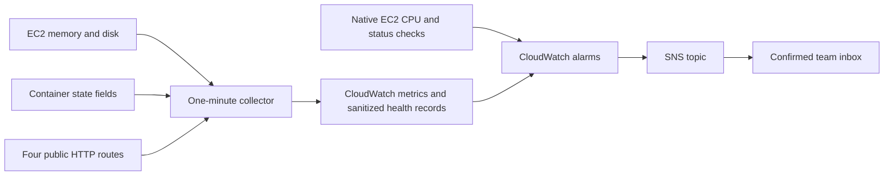

# Runtime monitoring and alerts

The optional monitoring stack observes the existing EC2 deployment. It adds a
CloudWatch dashboard, eight alarms, one SNS email topic, seven-day health-record
retention and a scoped publishing policy on the existing EC2 role. A separate
systemd timer samples the host once per minute. It does not recreate application
containers, apply migrations, change secrets or modify the release pipeline's
permissions.



## What is measured

| Signal | Alarm condition | Purpose |
| --- | --- | --- |
| CPU utilization | At least 80% in two of three five-minute periods | Sustained host pressure; uses basic EC2 metrics |
| EC2 status check | Failed in two consecutive one-minute periods | Host/system reachability failure |
| Memory usage | At least 85% in three consecutive one-minute periods | Memory pressure, using Linux available memory |
| Root disk usage | At least 80% in three consecutive one-minute periods | Disk pressure from images, data and logs |
| Application unhealthy count | At least one in three consecutive one-minute periods | Missing/stopped/unhealthy API or worker; repeated restarts |
| Supporting unhealthy count | At least one in three consecutive one-minute periods | Six database containers, RabbitMQ or Mailpit unhealthy |
| Public route unhealthy count | At least one in three consecutive one-minute periods | Unexpected HTTP result or timeout through CloudFront |
| Collector heartbeat | Missing in three of five one-minute periods while native EC2 status data exists | Broken collector, publishing permissions or dependency |

The collector publishes six custom metric series in `FoC/Runtime`, with only
`InstanceId` as a dimension. Container names and URLs are not metric dimensions.
CPU and status checks use existing `AWS/EC2` metrics. Most short releases should
not satisfy the consecutive-period alert thresholds; prolonged outages still do.
These thresholds are starting values, not a demonstrated capacity or availability
target.

The public routes are `/healthz` and `/sign-in` (expect 200), plus `/v1/orders` and
`/v1/wallets/me` (expect 401 without credentials). HTTP checks use GET, carry no
authentication and discard bodies. They check availability/routing and an auth
guard, not authenticated workflows or credit settlement. They run from EC2, so
they are not an independent external uptime probe if that host is unavailable.

Worker health means the process is running and has not repeatedly restarted;
workers without health checks are supported. Three new restarts between samples
also count as unhealthy. A live process does not prove queue consumption or
outbox progress. Service-owned business metrics can be added separately through
service contracts; the collector never queries business tables.

## Secrets and retention

The collector reads `/proc/meminfo`, root-filesystem capacity and selected Docker
state fields. It never requests Docker environment/configuration fields, raw
application logs, `.env`, JWT keys, database passwords or provider keys. CloudWatch
health records contain timestamps, aggregate metrics and bounded issue details
for known workload names only. Application logs remain in their existing local
Docker log driver.

AWS CLI uses the EC2 instance role. The added inline policy permits only
`cloudwatch:PutMetricData` in `FoC/Runtime` and creating/writing this instance's
health log stream. It grants no log read, database, secret-store, SNS publishing,
deployment or EC2 lifecycle permissions. The CloudWatch service publishes alarm
notifications through an account- and alarm-prefix-scoped SNS policy.

The timer runs as root to read Docker state, with filesystem protections,
credential files disabled and no shell command input. Docker access is privileged;
the script must remain reviewed operator code. Local configuration and previous
restart counters live in ignored, root-owned `.monitoring-state/`, mode 0700/0600.

Health records expire after seven days. Custom metrics, alarms, the dashboard,
logs and SNS usage can incur charges; free allowances are shared account-wide.
Keep the six metric series and fixed dimensions bounded, and review actual cost
in the team budget portal. This stack creates no additional compute instances.

## Install in order

Review and merge the monitoring changes through a PR. Before updating EC2, review
pending upstream deployment changes and apply any owning services' migrations
through their normal workflow. Monitoring installation itself performs no DDL.

### 1. Create monitoring resources from the PC

From the repository root, set the existing instance and a real team inbox in this
command. Run in Singapore using the operator's AWS SSO profile:

```bash
aws cloudformation deploy --profile foc --region ap-southeast-1 \
  --stack-name foc-monitoring \
  --template-file deploy/aws/monitoring/stack.json \
  --capabilities CAPABILITY_IAM \
  --parameter-overrides \
    InstanceId=i-REPLACE_WITH_EXISTING_INSTANCE \
    InstanceRoleName=foc-ec2-role \
    AlertEmail=alerts@example.com \
    EnableNotifications=false \
  --no-fail-on-empty-changeset
```

This stack manages monitoring resources and one inline role policy only; it does
not own or replace EC2, EBS volumes, CloudFront, database stacks or service images.
Review any account-policy denial directly rather than broadening the EC2 role to
administrator. SNS sends a subscription confirmation to the chosen inbox. Click
the confirmation link; SES sender verification/production access is unrelated to
this infrastructure notification subscription.

Alarm actions start disabled so installation gaps do not generate email alerts.
An alarm state can still be evaluated and displayed while actions are disabled.

### 2. Install the collector on EC2

In Session Manager Bash, inspect the checkout before pulling:

```bash
cd /opt/foc
git status --short --branch
```

After resolving any unexpected local changes:

```bash
git pull --ff-only origin main
```

Install using the same account/instance and public website as the release setup:

```bash
sudo python3 deploy/aws/scripts/install_monitoring.py \
  --account-id REPLACE_ACCOUNT_ID \
  --instance-id i-REPLACE_WITH_EXISTING_INSTANCE \
  --public-origin https://dexample.cloudfront.net
```

The installer checks the instance-role identity, writes only monitoring config
and its two systemd units, reloads systemd and enables the timer. Matching repeated
installs are supported. A different existing target is refused for review.
It does not install static AWS credentials or start/rebuild application services.

Inspect one read-only collection without publishing or saving restart counters:

```bash
sudo python3 deploy/aws/scripts/monitor_runtime.py --dry-run
```

Trigger a real collection and inspect the timer:

```bash
sudo systemctl start foc-monitoring.service
sudo systemctl status foc-monitoring.timer --no-pager
sudo journalctl -u foc-monitoring.service -n 20 --no-pager
```

Wait several minutes for CloudWatch data. In Singapore, open dashboard
`foc-monitoring`, log group `/foc/monitoring/health` and the eight
`foc-monitoring-*` alarms. Resolve collector or application issues before enabling
notifications. Verify the SNS email subscription is confirmed.

### 3. Enable alert actions

Repeat the stack deployment command from step 1 with the same target and inbox,
changing only `EnableNotifications=true`. No application redeployment is needed.
If an alarm is already ALARM when actions are enabled, an immediate email is not
guaranteed; verify notifications explicitly rather than assuming one was sent.

### 4. Test delivery without causing an application outage

After confirming the inbox and healthy metrics, from the PC:

```bash
aws cloudwatch set-alarm-state --profile foc --region ap-southeast-1 \
  --alarm-name foc-monitoring-public-routes \
  --state-value ALARM \
  --state-reason 'Notification delivery test; no application outage was induced' \
  --no-cli-pager
```

Expect an ALARM email. Normal metric evaluation will replace the temporary state
and should produce an OK email once the healthy condition is evaluated. Confirm
both delivery and alarm history. This verifies notifications, not a real outage
threshold or every possible failure mode. Do not stop databases or mutate real
wallet/order data to test alert delivery.

## Stop/start, rollout and failure behavior

The timer starts automatically on boot. It waits 90 seconds after boot before its
first scheduled collection, then runs once per minute without overlapping its
oneshot service. Application rollout does not replace or restart the timer.

Missing host/custom metrics are not treated as breaches for ordinary alarms.
Collector failure uses a metric-math gate on native EC2 status-check data, with
three-of-five evaluation to tolerate recent metric delays. Once EC2 is stopped
and native data is absent, this suppresses collector-missing alerts. This does not
distinguish intentional from unexpected EC2 stops, and it does not promise
immediate suppression while recently published data is still being evaluated.

A Docker daemon failure publishes unhealthy counts for the expected workloads.
If collection or log/metric publishing fails, no successful heartbeat is sent;
the heartbeat alarm can detect that while EC2 status data is present. Root disk
pressure can prevent local state writes; inspect the timer/journal and disk alarm.

No alarm stops, restarts, scales or terminates resources. Recovery actions remain
operator decisions. The runtime checks do not replace release readiness, backup
verification or authenticated Order/Credit tests.

## Maintenance and teardown

Disable alert actions through `EnableNotifications=false` before planned extended
maintenance. To pause only collection on EC2:

```bash
sudo systemctl disable --now foc-monitoring.timer
sudo systemctl stop foc-monitoring.service
```

Disabling collection while EC2 keeps running can trigger the collector alarm if
alert actions remain enabled. To resume, enable/start the timer and inspect data:

```bash
sudo systemctl enable --now foc-monitoring.timer
```

For final teardown, disable/stop the timer first, then delete the `foc-monitoring`
CloudFormation stack. This deletes its alarms, dashboard, topic/subscription,
health log group and its own inline publishing policy. Export health records first
if they are needed. It does not delete the instance role, existing SSM/SES/ECR
policies, EC2, application containers, environment files or database volumes.
Ignored monitoring state and the two unit files may then be deliberately removed.

## Validation and references

```bash
python -m unittest discover -s deploy/aws/tests -p test_monitoring.py -v
cfn-lint deploy/aws/monitoring/stack.json
```

Cloud foundation CI validates the template, unit syntax and monitoring tests,
including real Docker state inspection against its disposable database, with no
AWS credentials, emails or cloud mutations. Live installation, metric arrival,
email confirmation/delivery and alarm behavior still need target-account checks.

- [CloudWatch missing data](https://docs.aws.amazon.com/AmazonCloudWatch/latest/monitoring/alarms-and-missing-data.html)
- [CloudWatch metric math](https://docs.aws.amazon.com/AmazonCloudWatch/latest/monitoring/using-metric-math.html)
- [SNS alarm notifications](https://docs.aws.amazon.com/AmazonCloudWatch/latest/monitoring/Notify_Users_Alarm_Changes.html)
- [CloudWatch pricing](https://aws.amazon.com/cloudwatch/pricing/)
