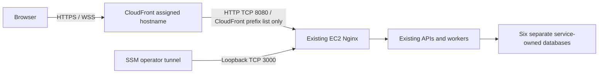

# Public HTTPS with CloudFront

This stage publishes the existing EC2 application at an AWS-assigned
`https://d….cloudfront.net` address. Users need only a browser. SSM remains the
private operator connection, and the original localhost tunnel remains usable.
Review/merge this branch and pass CI before updating EC2; the user runs all AWS
commands and owns commits, pushes and PRs.



The browser-to-CloudFront leg uses TLS; the CloudFront-to-EC2 leg uses **HTTP**.
This is a course-demo compromise, not end-to-end TLS. The EC2 security group
restricts TCP 8080 to AWS's CloudFront origin-facing prefix list. That identifies
the CloudFront network, **not a particular distribution**. Application identity
and role/participant decisions remain in the services. Nginx owns no service
credentials or role decisions. For stronger origin isolation/encryption, assess
VPC origins or a properly certified HTTPS origin in a separate change.

## Files and configuration

| File | Purpose |
| --- | --- |
| `compose.public.yaml` | Adds one web binding on IPv4 TCP 8080 and the public Nginx snippet; retains loopback 3000/8025. |
| `nginx-public/listener.conf` | Reuses the existing Nginx routes on port 8080 and marks forwarded protocol HTTPS on this CloudFront-only listener. |
| `scripts/public_https.py distribution` | Generates a local CloudFront request JSON; does not contact AWS or handle service secrets. |
| `scripts/public_https.py set-origin` | Changes only `FOC_PUBLIC_ORIGIN` in the existing EC2 environment, atomically and owner-only. |
| `scripts/validate.py --public` | Checks the merged public/private bindings, owned databases, workers and HTTPS browser origin. It cannot verify the AWS firewall. |

CloudFront uses AWS-managed **CachingDisabled** and **AllViewer** policies. All
seven application HTTP methods, Authorization, cookies, query strings, Origin
and WebSocket handshake headers reach Nginx. Error caching TTL is zero for the
configured 403/404/5xx responses. There is no CloudFront SPA error rewrite:
Nginx handles UI routes, while API failures retain their real status. Static
assets are also uncached initially; optimize only after correctness is proven.
PriceClass_200 is selected; it is not a promise of free usage or a spending cap.
No domain purchase, ALB, NAT gateway, WAF subscription or additional VM is added.

## 1. Check current AWS metadata (Windows Command Prompt)

Run on the PC where AWS CLI and the `foc` SSO profile are configured:

```cmd
aws sso login --profile foc
```

```cmd
aws ec2 describe-instances --profile foc --region ap-southeast-1 --instance-ids i-04e13b58b6a5cc072 --query "Reservations[0].Instances[0].{State:State.Name,PublicDNS:PublicDnsName,PublicIP:PublicIpAddress,SecurityGroups:SecurityGroups[].GroupId}" --output json --no-cli-pager
```

The instance must be running. Use the **current** PublicDNS, not the original
launch IP: an auto-assigned address can change after stop/start.

```cmd
aws ec2 describe-managed-prefix-lists --profile foc --region ap-southeast-1 --filters "Name=prefix-list-name,Values=com.amazonaws.global.cloudfront.origin-facing" --query "PrefixLists[].{Name:PrefixListName,Id:PrefixListId}" --output table --no-cli-pager
```

A successful `cloudfront list-distributions` with no rows means no distributions
exist; it does not prove creation permission. If a later call is denied, retain
the working private setup and diagnose the stated IAM/SCP restriction.

## 2. Restrict the origin firewall before adding its listener

In Singapore, open **EC2 → Security Groups → the instance's FoC security group
→ Edit inbound rules**. Preserve existing unrelated rules and inspect all groups
attached to the instance: security-group permissions are combined.

Add exactly one rule:

| Setting | Value |
| --- | --- |
| Type | Custom TCP |
| Port | 8080 |
| Source | The prefix-list ID for `com.amazonaws.global.cloudfront.origin-facing` from step 1 |
| Description | FoC CloudFront origin |

Do not choose Anywhere, your own IP or the viewer CloudFront IP ranges. Keep
3000, 8025, API, database and RabbitMQ ports closed to the internet. The prefix
list consumes **55** security-group rule slots, even though this is one entry.
If AWS reports a quota issue, resolve that explicitly; do not substitute Anywhere.

## 3. Generate and create one CloudFront distribution (PC)

Use a local checkout containing this merged change and a Python 3.11+ command
(`python` below; use the interpreter configured in VS Code if named differently).
In the repo root, replace the sample EC2 hostname with step 1's current PublicDNS:

```cmd
python deploy/aws/scripts/public_https.py distribution --origin-domain ec2-REPLACE.ap-southeast-1.compute.amazonaws.com
```

This writes ignored `deploy/aws/cloudfront-request.local.json`. It contains
public deployment metadata and an idempotent caller reference, not application
secrets. Keep/reuse the same file on uncertain retries; do not regenerate it to
retry creation or accidentally create a second distribution.

The following command **creates an AWS resource** using that reviewed request:

```cmd
aws cloudfront create-distribution --profile foc --distribution-config file://deploy/aws/cloudfront-request.local.json --query "Distribution.{Id:Id,Domain:DomainName,Status:Status}" --output table --no-cli-pager
```

Record the ID and `d….cloudfront.net` hostname. Creation can report InProgress;
the origin will not work until the EC2 overlay is running. If a retry returns
DistributionAlreadyExists, list the existing distribution instead of generating
a fresh request. Use the AWS console to inspect actual pricing/account policies;
the helper does not select a paid flat-rate subscription.

## 4. Update EC2 without replacing its environment or databases

In the EC2 Session Manager **Bash** terminal:

```bash
cd /opt/foc
```

```bash
git status --short --branch
```

If tracked changes exist, inspect/preserve them before pulling. Generated ignored
`.env`, keys, CLI state and database volumes must remain intact.

```bash
git pull --ff-only origin main
```

Replace the hostname with the distribution assigned in step 3:

```bash
python3 deploy/aws/scripts/public_https.py set-origin --origin https://dREPLACE.cloudfront.net
```

```bash
python3 deploy/aws/scripts/validate.py --public
```

The helper changes only the browser origin; no secret generation, account
bootstrap or database reset is needed. The lowercase assigned hostname must
replace the example. Build the changed web image, then recreate the selected
web/Chat containers so the listener and allowed Origin take effect:

```bash
sudo docker compose --env-file deploy/aws/.env -f deploy/aws/compose.yaml -f deploy/aws/compose.public.yaml --profile chat --profile admin --profile voice-assist build web-client
```

```bash
sudo docker compose --env-file deploy/aws/.env -f deploy/aws/compose.yaml -f deploy/aws/compose.public.yaml --profile chat --profile admin --profile voice-assist up -d web-client chat-service chat-outbox
```

```bash
sudo docker compose --env-file deploy/aws/.env -f deploy/aws/compose.yaml -f deploy/aws/compose.public.yaml --profile chat --profile admin --profile voice-assist ps -a
```

```bash
curl --fail http://127.0.0.1:3000/healthz
```

```bash
curl --fail http://127.0.0.1:8080/healthz
```

Both health endpoints should return `{"status":"ok"}`. Existing container count
remains 16 application/support plus six databases; the overlay adds a listener,
not another container. Retain both `-f` arguments for later public-stack commands.

## 5. Verify the public site (PC/browser)

Check rollout status, replacing the example ID:

```cmd
aws cloudfront get-distribution --profile foc --id REPLACE_DISTRIBUTION_ID --query "Distribution.{Domain:DomainName,Status:Status,Enabled:DistributionConfig.Enabled}" --output table --no-cli-pager
```

Once Deployed, open `https://d….cloudfront.net` directly, without the SSM tunnel.
Verify from a separate browser profile/device as well:

- `/healthz` returns 200, HTTP redirects to HTTPS, and direct EC2 TCP 8080 access
  from the PC is blocked by the firewall.
- `/v1/internal/…` remains 404 through CloudFront. APIs/DB/broker/mailbox are not
  independently public. Mailpit remains available only via its own private SSM
  tunnel to port 8025; messages are not delivered to real NUS inboxes.
- Sign in as the cloud admin; reload to exercise refresh-cookie rotation; sign
  out and verify the session is rejected. Use fresh cloud accounts/data.
- Create a supplier through normal admin UI if needed. Register two fresh users,
  retrieve test OTPs privately in Mailpit, and check real wallet allocation.
- Create/accept/fulfil/complete an errand; inspect actual reward transfer. Check
  cancellation/failure/expiry refunds separately and denied participant actions.
- Open Chat in two sessions, verify connection/reconnect and real message delivery.
  The exact public Origin must match the allowed value; localhost Chat is no
  longer an allowed browser Origin after this switch.
- Voice requires its real provider key and browser microphone permission. A
  healthy container with a blank key does not mean drafting works.

These are acceptance checks to perform, not results established by helper/CI
tests. CI uses isolated echo upstreams only for routing/header/upgrade checks.

## Resume, rollback and teardown

Stopping EC2 pauses compute, but retained storage and other resources can still
incur charges. The distribution stays configured. On restart, check PublicDNS
again; if it changed, update the existing distribution's origin DomainName in
the console and wait for deployment. Do not recreate the distribution: retaining
the same public hostname preserves the configured browser origin.

To withdraw public access, remove only the added TCP 8080 firewall rule (or disable
the distribution). The private port-3000 SSM tunnel still works. To restore the
private-only web container later, run the original private Compose command for
`web-client`; this removes its public binding. No volume deletion is needed.
For localhost Chat again, deliberately restore the exact localhost origin and
recreate Chat; do not regenerate keys or edit wallet data.

Before final teardown, disable and then delete the CloudFront distribution,
remove its added firewall rule and deliberately clean up retained AWS storage
after approved backups. The NUS deadline remains 11 December 2026. This branch
does not implement ECR publishing, automated CD, backup/restore or availability
across multiple servers.

## Sources

- [CloudFront HTTPS and assigned certificates](https://docs.aws.amazon.com/AmazonCloudFront/latest/DeveloperGuide/using-https-viewers-to-cloudfront.html)
- [CachingDisabled policy](https://docs.aws.amazon.com/AmazonCloudFront/latest/DeveloperGuide/using-managed-cache-policies.html#managed-cache-policy-caching-disabled)
- [AllViewer policy](https://docs.aws.amazon.com/AmazonCloudFront/latest/DeveloperGuide/using-managed-origin-request-policies.html#managed-origin-request-policy-all-viewer)
- [WebSocket forwarding](https://docs.aws.amazon.com/AmazonCloudFront/latest/DeveloperGuide/distribution-working-with.websockets.html)
- [CloudFront origin-facing prefix list](https://docs.aws.amazon.com/AmazonCloudFront/latest/DeveloperGuide/LocationsOfEdgeServers.html#managed-prefix-list)
- [Prefix-list rule weight](https://docs.aws.amazon.com/vpc/latest/userguide/working-with-aws-managed-prefix-lists.html)
