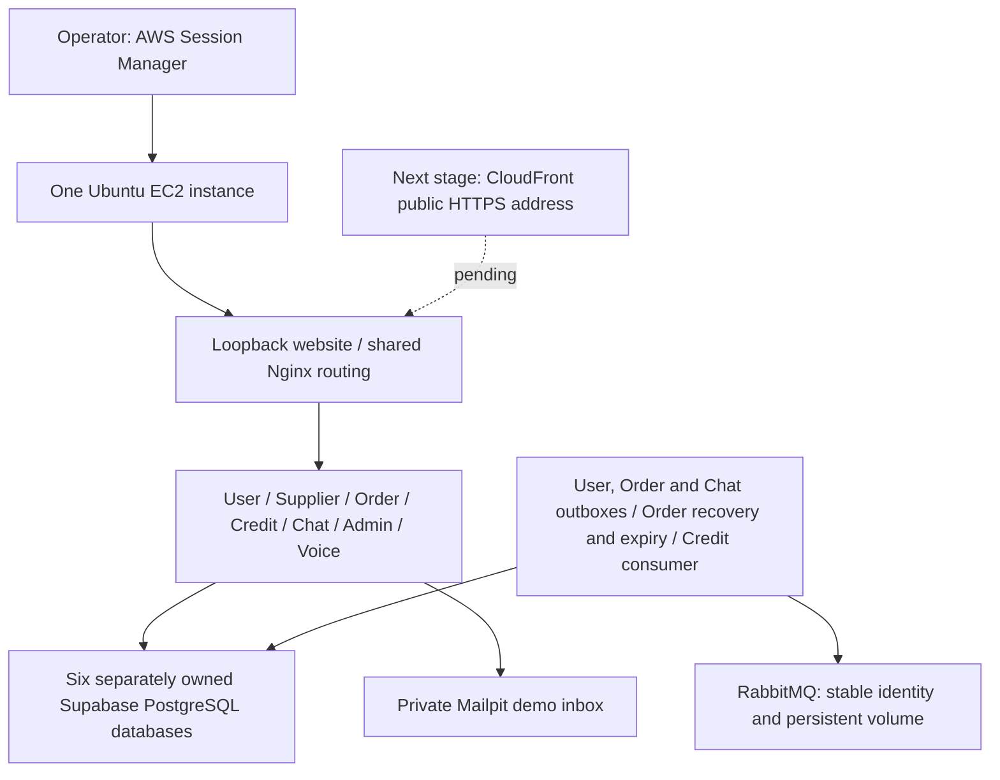

# AWS sandbox foundation

This is a separate, single-EC2 demo environment. It reuses the existing service
Dockerfiles and versioned APIs/events. The root `compose.yaml` remains the local
development stack. No service business-logic changes, migration reset, ECR publication,
GitHub AWS credentials or public ingress are performed by this configuration.

The first stage is private: the website binds to `127.0.0.1:3000` and the demo
mailbox to `127.0.0.1:8025`. Six independent Supabase PostgreSQL databases retain
their existing project IDs, ports and migration directories. Supabase CLI is used
in **database-only** mode: Auth, Data API, Studio and the other development
services are not started. This is a self-hosted course sandbox, not managed
Supabase hosting or a high-availability production deployment.



The database box represents six separate databases, not a shared schema or
cross-service access. Voice is stateless. Every process receives only its own
database URL and the service credentials it needs. Order uses real Credit.

## Prerequisites and existing AWS setup

- Dedicated Ubuntu 24.04 amd64 EC2 server with Docker Engine and Compose installed.
  The initial `foc-demo` candidate has 4 vCPUs, 16 GiB RAM and 80 GiB encrypted
  gp3 storage. Capacity has not been load-tested; measure before resizing.
- Singapore (`ap-southeast-1`), a VPC/public subnet and internet gateway, public
  IPv4 for outbound downloads, and `foc-ec2-sg` with no inbound rules initially.
  No NAT gateway, load balancer or VPC endpoint is required for this stage.
- Instance profile `foc-ec2-role` with `AmazonSSMManagedInstanceCore`, and a working
  Session Manager connection. No SSH port or key pair is required.
- Python 3.11+ and OpenSSL on the host. Docker's official Ubuntu installation is
  documented at <https://docs.docker.com/engine/install/ubuntu/>.
- A reviewed commit pushed to the chosen branch. The user owns commits, pushes
  and PRs. Do not clone an unreviewed branch onto a shared environment.

NUS staff confirmed an allocation of **SGD 50 per person**; use the actual group
size and monitor the remaining group allowance. AWS's instance prices are shown
in **USD**. The observed `t3a.xlarge` compute rate was USD 0.1888/hour; disk,
public IPv4 and other services are additional. Standard CPU-credit mode avoids
surplus CPU-credit charges but can throttle sustained CPU usage. Stop the server
when idle; retained storage continues billing. Staff reports closure above the
group cap, with enforcement timing/mechanism unconfirmed. All NUS sandbox data
is scheduled for deletion on **11 December 2026**; an EC2 volume is not an
off-sandbox backup.

## 1. Get the reviewed source onto EC2

Run commands in the EC2 Session Manager terminal. Start a Bash session so the
later interactive account-bootstrap commands use consistent shell behavior:

```bash
bash
```

Create an application directory owned by the session user:

```bash
sudo install -d -m 0750 -o "$(id -u)" -g "$(id -g)" /opt/foc
```

After the branch has been pushed, clone it into this empty directory:

```bash
git clone --branch chore/cloud-deployment-foundation --single-branch https://github.com/AY2627S1-CS3219-P6/foc.git /opt/foc
```

```bash
cd /opt/foc
```

If the checkout already exists, inspect `git status` first and preserve local
configuration; do not repeat cloning, reset the checkout or overwrite files.
Use an approved deployment credential if repository access is private; never
put a personal access token in the clone URL or paste it into chat.

## 2. Generate cloud-only secrets once

Run as `ssm-user`, **without sudo**, so the non-root User containers can read
their owner-only mounted RSA keys:

```bash
python3 deploy/aws/scripts/generate_env.py
```

This creates ignored `.env`, an RSA key pair and a separate operator-only
database-admin secret file. It generates unique admin/runtime passwords for
each database, separate OTP/Supplier/Chat/Order-to-Credit secrets and broker
credentials. It never reads laptop environments and refuses to overwrite an
existing environment or secret directory. Preserve this state across updates;
do not rerun it to rotate keys or recover from a failed startup.

The initial exact browser origin is `http://localhost:3000` for private tunnel
checks. Public CloudFront HTTPS must be configured before presenting this as a
public deployment. User remains in production secure-cookie mode; authenticated
browser/session-refresh behavior must be verified through the final HTTPS URL.

## 3. Start and migrate the six databases

```bash
python3 deploy/aws/scripts/prepare_databases.py --ec2-sandbox
```

This is an explicit operator step, never an application startup hook. It uses
temporary Node 22 tooling containers with the host Docker socket and the same
absolute source paths. Each service's exact lockfile-pinned Supabase CLI is
installed with `npm ci`; host Node/npm and Supabase account login are unnecessary.
The tooling has host-administration access, so run only reviewed repository code.

For each owned service it starts/resumes its Supabase PostgreSQL container,
rotates initially configured database login passwords to a generated private
admin password, applies that service's pending canonical Supabase migrations,
creates the dedicated runtime login and enables restart after host reboot.
It also writes a persistent database authentication configuration requiring SCRAM
passwords for TCP connections, with one initial DB restart to activate it. CLI
development trust rules are not accepted as cloud authentication. Later runs
reuse the configuration and reload it without deliberately restarting the DB.
User/Order/Credit/Chat/Admin inherit their existing migration-defined application
role. Supplier receives CRUD/sequence access to its own `supplier_service`
schema only. Append-only table restrictions remain in the existing migrations.
The other vendor login passwords are hardened too: these SQL-only projects
must not later be used as full development Auth/Data API/Studio stacks.

| Owner | Supabase project/container suffix | Host DB port | Runtime login |
| --- | --- | --- | --- |
| User | `user-service` | 15422 | `foc_user_runtime` |
| Supplier | `supplier-service` | 55322 | `foc_supplier_runtime` |
| Order | `order-service` | 16422 | `foc_order_runtime` |
| Credit | `credit-service` | 16522 | `foc_credit_runtime` |
| Chat | `foc-chat-service` | 17422 | `foc_chat_runtime` |
| Admin | `admin-service` | 17522 | `foc_admin_runtime` |

Supabase manages database volumes separately from the application Compose
project. Its host ports are not public endpoints: keep **all database ports
closed in the EC2 security group**, including after public web access is added.
Never run `supabase db reset`, volume pruning or test truncation on this server.
Do not copy local user/wallet data. Create fresh demo accounts through normal APIs.

For later additive migrations, run the helper again with the same generated
secrets, or select one owner, for example:

```bash
python3 deploy/aws/scripts/prepare_databases.py --ec2-sandbox --service order
```

It uses the generated admin credential and `migration up --db-url`; the default
local CLI password is deliberately no longer valid. Routine recovery uses the
existing containers/volumes, not a reset. Errors identify the service and step
while suppressing dependency output that could contain connection credentials.

## 4. Validate and start the application

```bash
python3 deploy/aws/scripts/validate.py
```

This renders Compose into memory and checks private bindings, owned database
URLs, matching service credentials, workers and broker persistence. It does not
prove service connectivity. Do not print plain `docker compose config`: it
contains resolved secrets.

Start the full team feature set (including optional Chat/Admin/Voice profiles):

```bash
sudo docker compose --env-file deploy/aws/.env -f deploy/aws/compose.yaml --profile chat --profile admin --profile voice-assist up --build -d
```

```bash
sudo docker compose --env-file deploy/aws/.env -f deploy/aws/compose.yaml --profile chat --profile admin --profile voice-assist ps
```

```bash
curl --fail http://127.0.0.1:3000/healthz
```

The web health endpoint tests Nginx only. Also inspect every API's readiness and
worker status in Compose; a working homepage alone is insufficient. Background
workers have restart policies but no independent functional heartbeat, so real
reserve/release/transfer and recovery flows must be checked separately.

All internal User/Order/Credit endpoints are blocked at this browser ingress;
service-to-service calls keep using their existing authenticated contracts.
Routing and Chat WebSocket upgrades reuse the shared web-client Nginx file.
The deployment snippet adds only a health route and internal-route restriction.

Voice uses its real provider and remains unavailable until its owner supplies
an appropriate server-side key in the ignored environment. No fake provider or
successful fake Credit fallback is enabled. Begin with one Voice process because
its existing rate limiter is process-local.

## 5. Bootstrap a cloud Super Admin privately

In the Bash terminal, collect credentials without adding the password to shell
history. Use an address appropriate for this private demo; bootstrap does not
send the normal registration OTP.

```bash
read -r -p 'Admin username: ' BOOTSTRAP_SUPER_ADMIN_USERNAME
```

```bash
read -r -p 'Admin email: ' BOOTSTRAP_SUPER_ADMIN_EMAIL
```

```bash
read -r -s -p 'Admin password: ' BOOTSTRAP_SUPER_ADMIN_PASSWORD
```

```bash
export BOOTSTRAP_SUPER_ADMIN_USERNAME BOOTSTRAP_SUPER_ADMIN_EMAIL BOOTSTRAP_SUPER_ADMIN_PASSWORD
```

```bash
sudo --preserve-env=BOOTSTRAP_SUPER_ADMIN_USERNAME,BOOTSTRAP_SUPER_ADMIN_EMAIL,BOOTSTRAP_SUPER_ADMIN_PASSWORD docker compose --env-file deploy/aws/.env -f deploy/aws/compose.yaml run --rm -e BOOTSTRAP_SUPER_ADMIN_USERNAME -e BOOTSTRAP_SUPER_ADMIN_EMAIL -e BOOTSTRAP_SUPER_ADMIN_PASSWORD user-service bootstrap-super-admin
```

```bash
unset BOOTSTRAP_SUPER_ADMIN_USERNAME BOOTSTRAP_SUPER_ADMIN_EMAIL BOOTSTRAP_SUPER_ADMIN_PASSWORD
```

This invokes the existing one-shot User command with ephemeral environment
values; the long-running API does not retain bootstrap credentials. The existing
bootstrap guards/idempotency remain authoritative. If sudo disallows preserving
these specific variables, stop and diagnose rather than adding administrator
permissions or a public bootstrap endpoint.

## 6. Verification and remaining release work

Mailpit is a **private demo SMTP sink**, not delivery to NUS inboxes. This branch
does not claim external email integration. Its inbox must remain loopback-only
and accessible through an authorized Session Manager port-forwarding session.
Provider SMTP TLS/authentication requires coordination with the User owner.

The next public-access step uses an AWS-assigned CloudFront HTTPS hostname,
without buying a domain. It is **not implemented by this private foundation**.
It must disable caching for authenticated requests, forward cookies/auth/query
strings and Chat upgrade/origin headers, support all required API methods,
restrict EC2 origin access, set the exact Chat browser origin, and verify refresh
cookies and Voice microphone access. Do not simply open all host ports.

Before claiming deployment complete, demonstrate from the final HTTPS site:
registration/demo OTP limits, login/refresh, Supplier access, funded Order
creation, competing/forbidden actions, completion transfer, cancel/expiry/failure
release, Chat reconnect and admin reads. Show actual Wallet/ledger effects after
asynchronous processing. Broker/outbox/consumer restart tests must preserve data.

This branch builds from reviewed source on EC2 for the first manual release.
ECR publication, GitHub AWS authentication, automated release/rollback, backup
and restore rehearsal, monitoring and teardown automation are subsequent work.
Do not claim these from the existing CI or a running container. Application
rollback also does not undo database migrations.

## Stop, resume and protect data

For a short pause, stop EC2 through its **Instance state → Stop instance** menu.
Docker and the explicitly restart-enabled DB/app containers should resume after
the host starts; verify readiness and real worker progress after each resume.
This has not yet established a successful reboot/persistence test. A stopped
instance can receive a different public IPv4 on restart; future CloudFront origin
configuration must account for that or use a budgeted stable-address strategy.

To stop only the application while keeping EC2/databases running:

```bash
sudo docker compose --env-file deploy/aws/.env -f deploy/aws/compose.yaml --profile chat --profile admin --profile voice-assist stop
```

Use the same profiles with `start` to resume existing containers. Use `up -d`
after configuration/image changes. Do not use `down -v`, prune volumes or destroy
the database containers as a routine shutdown operation.

RabbitMQ has a named data volume and stable node identity; this improves
restart/recreation persistence but is not broker replication or off-host backup.
Keys and database-admin state under `deploy/aws/secrets/` must remain stable and
be backed up through approved private encrypted storage. Never commit those
files, database exports, captured messages, user credentials or filled `.env`.
Volume retention after instance termination is not a backup, and retained volumes
continue billing. Inventory and deliberately clean them after backed-up teardown.

## Checks and source references

```bash
python3 -m unittest discover -s deploy/aws/tests -v
```

The default tests check secret handling, origin validation and repository
metadata; they skip the opt-in live database tests. The existing CI detects cloud
changes and calls reusable `cloud-foundation.yml`; its result is included in the
required `CI passed` aggregation without removing existing component checks. It
generates throwaway CI secrets, validates real Compose rendering, bootstraps one
User Supabase project on its disposable runner, checks restricted TCP access and
default-password rejection, and syntax-checks Nginx with the optional include.
Those CI checks do not deploy to AWS or prove the full six-database live workflow.
Never set `CLOUD_DB_SMOKE=1` on a real application database host for convenience.

Operational patterns reference [Docker Compose production guidance](https://docs.docker.com/compose/how-tos/production/),
[Supabase CLI](https://supabase.com/docs/reference/cli/introduction),
[AWS Session Manager](https://docs.aws.amazon.com/systems-manager/latest/userguide/session-manager.html)
and the existing FoC service configuration/migrations. The peer review informed
the choice of a small EC2/Compose first release; no peer deployment code was copied.

